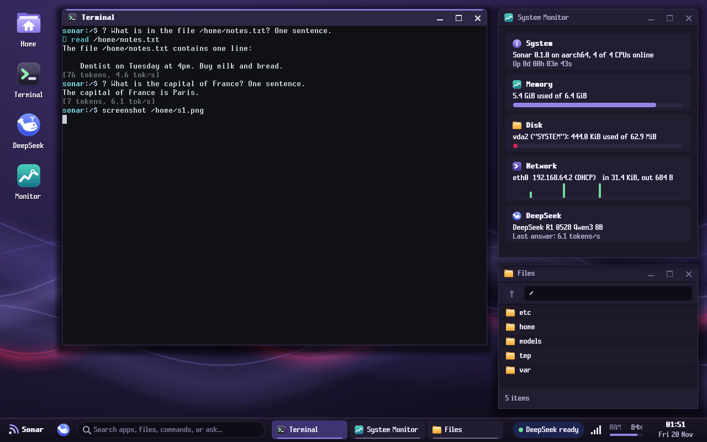
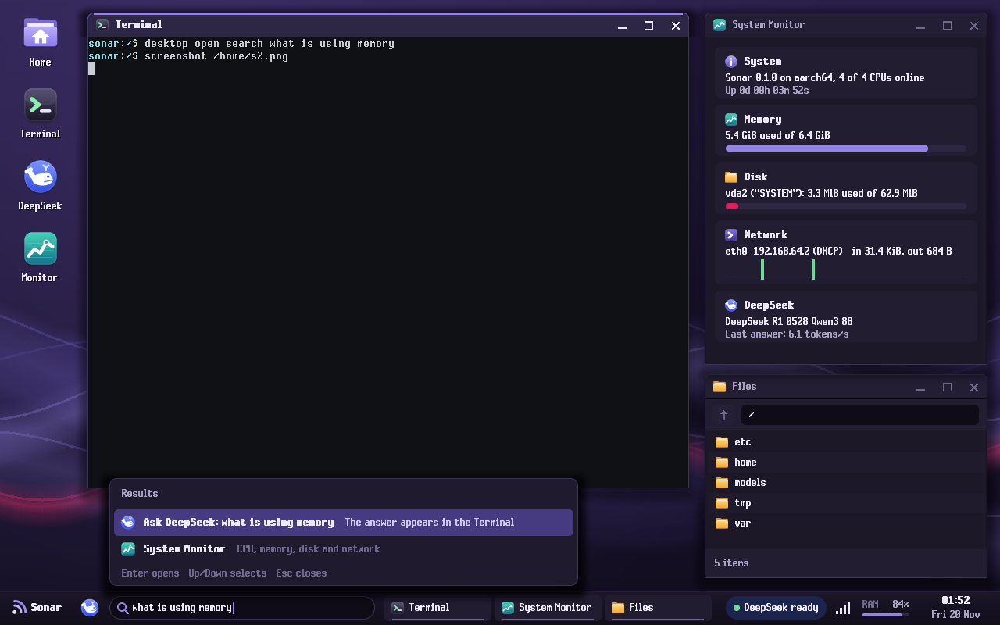
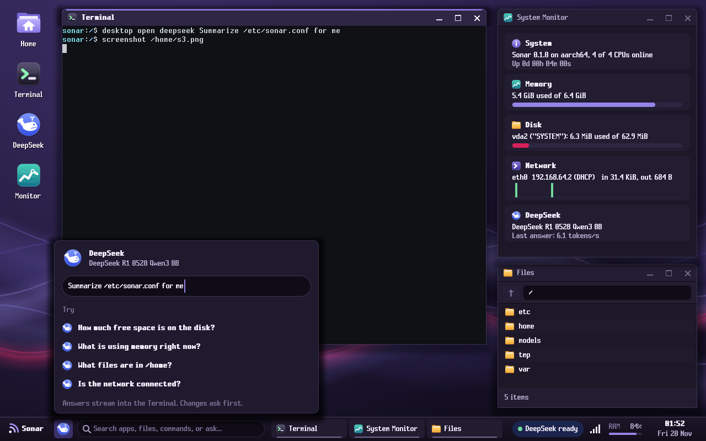
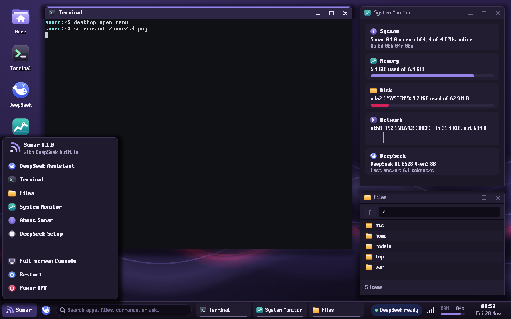
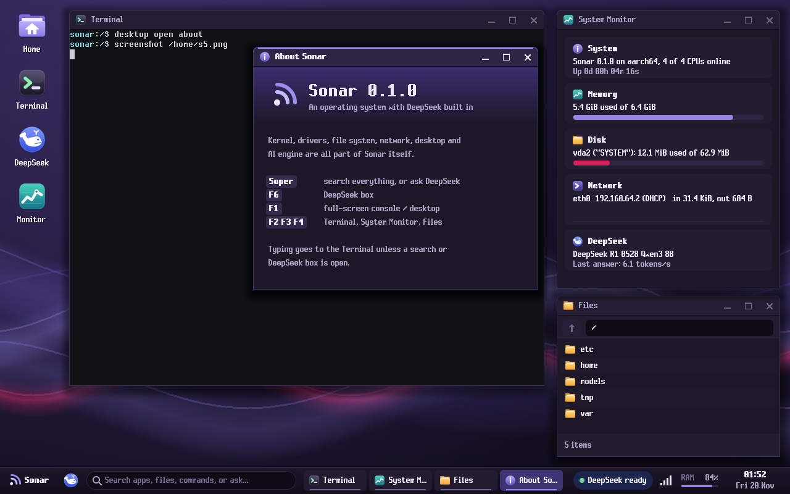

# Sonar

Sonar is an operating system for 64-bit Arm computers with DeepSeek built
in. The kernel, drivers, file system, network stack, desktop and AI engine
are all written from scratch for it, in C and assembly, with no third-party
code. DeepSeek runs on the computer's own processors, with no cloud service.
It answers questions and, through an agent harness modeled on DeepSeek
Harness, can use the system's tools with your approval.

Version 0.1.0. It runs in QEMU and in Apple's Virtualization framework
(tested with Keelson on an M1 MacBook Pro). It boots through UEFI firmware
as it would on a real computer and has drivers for NVMe disks and USB
keyboards and mice, but not yet for a real laptop's Wi-Fi or Apple's
built-in keyboard and trackpad. See [docs/hardware.md](docs/hardware.md).



| Universal search | The DeepSeek box |
| --- | --- |
|  |  |
| **The Sonar menu** | **About Sonar** |
|  |  |

Screenshots from Sonar running in Keelson on an M1 MacBook Pro, with the
DeepSeek-R1-0528-Qwen3-8B model (Q4_K_M), taken with Sonar's own
`screenshot` command.

## What's in it

- **Kernel:** AArch64, boots from QEMU `-kernel`, U-Boot-style loaders
  (Linux `Image` header) or UEFI (`BOOTAA64.EFI`). MMU, physical page
  allocator, heap, GICv3, timer, multi-core startup through PSCI.
- **Drivers:** PL011 serial, PCIe (ECAM, MSI-X), virtio
  block/network/GPU/input/entropy/console, NVMe, xHCI USB with hubs and HID
  keyboards and mice, firmware framebuffers (UEFI GOP,
  `simple-framebuffer`), PL031 clock.
- **SonarFS:** an extent-based file system ([format](docs/sonarfs.md))
  with a metadata journal, and a host tool that builds and checks images.
- **Network:** Ethernet, ARP, IPv4, ICMP, UDP, TCP, DHCP, DNS, TLS 1.3
  (without certificate checks); `ping`, `host`, and `fetch` over HTTP and
  HTTPS.
- **Updates:** `update` installs signed kernels from this repository's
  GitHub Releases (Ed25519 signature and SHA-256, checked again by the
  UEFI loader at every boot, with fallback to the built-in kernel)
  ([docs/updates.md](docs/updates.md)).
- **Desktop:** a compositor with windows, a permanent taskbar with a
  DeepSeek button and universal search (apps, commands, files, arithmetic,
  questions), a terminal, a system monitor and a file browser
  ([docs/desktop.md](docs/desktop.md)).
- **DeepSeek:** a GGUF inference engine (llama, qwen2, qwen3 models;
  llama.cpp quantizations; NEON and int8 dot-product code). At first boot
  you choose which DeepSeek-R1 model to use, from the ones on the disks,
  with the RAM each one needs.
- **Harness:** a native implementation of DeepSeek Harness's design: tools
  (`bash`, `read`, `grep`, `write`, `edit`, `web_fetch`, `todo_write`),
  permission modes with approval prompts, JSONL session logs, resume and
  compaction ([docs/harness.md](docs/harness.md)).

How it fits together: [docs/architecture.md](docs/architecture.md).

## Build

You need clang and ld.lld (LLVM), QEMU (`qemu-system-aarch64`) and Python 3.
On macOS with Homebrew:

```bash
brew install llvm lld qemu
```

```bash
make
```

This builds `build/Image`, the kernel (about 330 KB).

## Run

| Command | |
| --- | --- |
| `make run` | boot in QEMU with the serial console in this terminal (Ctrl-A X quits) |
| `make run-desktop` | boot with a display window and the desktop |
| `make esp` | build `build/esp.img`, a UEFI boot disk (for a USB stick) |
| `make run-uefi` | boot `build/esp.img` through UEFI firmware (edk2) in QEMU |
| `make smoke` | boot once and check the shell, file system and CPUs |
| `make test-host` | build the AI engine for this computer and run the TCP and crypto tests |
| `make test-update` | install updates end to end in QEMU with UEFI, from a stand-in for GitHub |

Options: `MODEL=path/to/model.gguf` attaches a model; `RAM=8G CPUS=4` set
the guest's memory and processors (defaults 2G and 4). On an Apple silicon
Mac QEMU uses the Hypervisor framework, so the guest runs at nearly full
speed.

The first `make run` creates `build/system.img` (512 MiB, SonarFS), which
keeps your files and settings between boots. Delete it to start over.

## DeepSeek

Sonar reads GGUF model files. It was tested with
DeepSeek-R1-0528-Qwen3-8B at Q4_K_M (5.0 GiB, the file Ollama downloads for
`deepseek-r1:8b`), which needs about 6 GiB of guest RAM:

```bash
make run-desktop MODEL=path/to/DeepSeek-R1-0528-Qwen3-8B-Q4_K_M.gguf RAM=8G
```

The model is attached as a read-only disk. At the first boot, setup lists
the models it found and the RAM each needs, and asks for the context length
and whether DeepSeek should reason before answering. Run `setup` again to
change, or `models` to see what is installed. You can also copy a model into
`/models` on the system disk:

```bash
python3 tools/sonarfs.py put build/system.img model.gguf /models/model.gguf
```

Then ask:

```
sonar:/$ ? How much free space does the root file system have?
● bash df -h
DEVICE   LABEL             SIZE        USED        FREE USE%
vdb1     SYSTEM       254.9 MiB   572.0 KiB   254.4 MiB   0%
The root file system (vdb1) has 254.4 MiB of free space.
[47 tokens, 5.9 tok/s]
```

`dsh` opens the interactive harness prompt. `explain COMMAND` asks
DeepSeek to explain a command's output. With 4 cores the 8B model
produced 4–6.5 tokens per second in Apple's Virtualization framework on an
M1 MacBook Pro, and about 5–6 in QEMU.

Model card: [deepseek-ai/DeepSeek-R1-0528-Qwen3-8B](https://huggingface.co/deepseek-ai/DeepSeek-R1-0528-Qwen3-8B)
(MIT license).

## Shell

`help` lists the commands. Some of them:

| | |
| --- | --- |
| files | `ls`, `cd`, `cat`, `head`, `write`, `append`, `cp`, `mv`, `rm`, `mkdir`, `find`, `grep`, `stat`, `wc`, `hexdump` |
| disks | `df`, `disks`, `mount`, `mkfs`, `fstest` |
| network | `ifconfig`, `dhcp`, `ping`, `host`, `fetch`, `netstat`, `arp` |
| system | `info`, `uptime`, `config`, `time`, `desktop`, `screenshot`, `setup`, `models`, `update`, `sha256` |
| DeepSeek | `?`, `dsh`, `chat`, `explain` |

The shell has no pipes, but `>` and `>>` redirect output to files.

## Tests

- `make smoke`: boots, runs `info`, `fstest` (random file operations,
  checked) and `smptest` (the same computation on one and all CPUs).
- `make test-net`: the kernel's TCP code against a simulated network that
  drops, reorders and duplicates packets.
- `make test-crypto`: SHA-2, HMAC, HKDF, ChaCha20-Poly1305, X25519 and
  Ed25519 against OpenSSL's results and RFC test vectors.
- `make test-update`: signed updates in QEMU with UEFI firmware: bad
  signatures and tampered images rejected, install, boot, fallback after
  a kernel that fails to start, rollback ([docs/updates.md](docs/updates.md)).
- `make test-host`: builds `build/aitest`, the AI engine for the host, to
  run a model directly (`build/aitest MODEL.gguf --chat "hello"`).
- `python3 tools/sonarfs.py fsck build/system.img` checks a disk image the
  kernel wrote.

## Limitations

- Tested in virtual machines only. A real Apple laptop also needs drivers
  for its Wi-Fi chip and its SPI keyboard and trackpad, and Apple's GPU and
  interrupt controller (AIC) are not documented
  ([docs/hardware.md](docs/hardware.md)).
- No user-space programs or processes: everything runs in the kernel.
- No IPv6. HTTPS does not verify certificates, so it protects against
  eavesdropping but not against an attacker who can intercept traffic;
  updates are safe anyway because they are signed
  ([docs/updates.md](docs/updates.md)).
- Updates start only on UEFI boots, and while the GitHub repository is
  private, devices need a token to see its releases.
- The SonarFS journal covers metadata only: after a power cut the file
  system is consistent, but a file being written can hold old or partly
  new data.
- After a UEFI boot, changes are kept only if the boot disk has a system
  partition (`mkesp.py --system`); otherwise the system image is copied
  to RAM and changes are lost at power-off.
- The harness reimplements DeepSeek Harness's design; it is not the dsh
  program, which needs Node.js.
