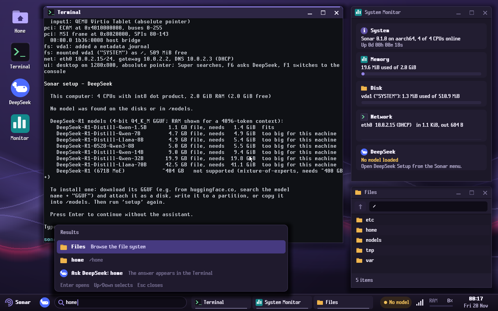

# The desktop

When Sonar has a display, it starts a windowed desktop. Without one (for
example `make run`, which has only a serial console), it uses the text
console alone.

```bash
make run-desktop
```

```bash
make run-desktop MODEL=path/to/DeepSeek-R1-0528-Qwen3-8B-Q4_K_M.gguf RAM=8G
```

The display can be a virtio-gpu device, or the framebuffer that UEFI
firmware (GOP) or a device tree (`simple-framebuffer`) describes. Input
comes from virtio keyboard, mouse and tablet devices, or from USB
keyboards, mice and absolute pointers (as in Apple's Virtualization
framework). With a tablet or absolute pointer the pointer follows the
host's mouse exactly.



## What is on screen

The look is a deep violet theme with lavender and crimson accents and a
ribbon wallpaper, in the spirit of the classic Linux desktops (Gentoo's
purple, Debian's swirl red), drawn with Sonar's own artwork.

**The taskbar** is always at the bottom of the screen. From left to right:

- **Sonar menu:** every application, plus Full-screen console, Restart
  and Power Off. Right-clicking the desktop opens it too.
- **DeepSeek button** (the whale): a box where you type a question, with
  suggested questions and the model in use.
- **Search field:** universal search (below).
- **Window buttons:** one per open window. Click to bring a window to the
  front, or to minimize it when it already is.
- **Tray:** DeepSeek status (ready, thinking, or no model), network,
  memory use and the clock (UTC). Point at an item for details; clicking network or
  memory opens System Monitor.

**Desktop launchers** on the left: Home, Terminal, DeepSeek and Monitor.

**Windows** have minimize, maximize and close buttons and move by their
title bars. Maximizing the Terminal re-wraps its text for the new size.

- **Terminal:** the system console, where the shell, `?` questions and
  `dsh` run. It is the same console as on the serial port.
- **System Monitor:** CPUs, memory and disk use, network traffic over the
  last minute, and the DeepSeek model with its last speed.
- **Files:** a browser for the file system. Click a folder to open it,
  the arrow to go up, a file to select it. A selected file has **View**
  (its first 40 lines in the Terminal) and **Ask DeepSeek** (a summary of
  it).
- **About:** the version and the keyboard shortcuts.

On wide screens (1200 pixels or more) System Monitor and Files open beside
the Terminal. Screens 2400 pixels or wider are drawn at double size.

## Universal search

Press **Super** (the Windows or Command key) anywhere, or click the search
field, and type. Results update as you type:

- **Applications**, by name or by what they do ("ram" finds System
  Monitor).
- **Commands:** a known command name runs that command line in the
  Terminal (`ls /home`, `ping 10.0.2.2`); a partial name lists matching
  commands.
- **Files and folders** on the system disk whose names match. Opening one
  shows it in Files. The index is built when search opens (at most once
  every 30 seconds, and only while no command is running).
- **Arithmetic:** `12*7+3` shows `= 87`.
- **Ask DeepSeek:** always offered; placed first when the text looks like
  a question.

Up and Down choose a result, Enter opens it, Esc closes search.

## DeepSeek everywhere

DeepSeek is part of the system, not an application: the engine and its
agent harness are in the kernel ([harness.md](harness.md)). The desktop
gives it several entry points:

| From | How |
| --- | --- |
| Anywhere | **Super**, type, Enter; or **F6** for the DeepSeek box |
| Taskbar | the whale button, the search field, the DeepSeek status chip |
| Sonar menu | DeepSeek Assistant, DeepSeek Setup |
| Desktop | the DeepSeek launcher |
| Files | **Ask DeepSeek** on any file |
| Terminal | `? question`, `chat`, `dsh` |

All of them send the question to the shell as `? question`, so the answer
streams into the Terminal with the same tools, permission prompts and
conversation as typing it there. DeepSeek can then read and write files,
run commands, fetch web pages and inspect the system.

### Why not DeepSeek Harness or AnythingLLM?

Both are Node.js applications (AnythingLLM also uses Electron or Docker).
Running them needs a Linux-compatible user space: processes, a POSIX
system-call layer, dynamic linking, threads, sockets and TLS. Sonar has
none of that yet; everything runs in the kernel. A Linux translation layer
would be a larger project than the rest of Sonar. Instead Sonar has its own
harness modelled on DeepSeek Harness (the same tool names and agent loop),
written in C, which is what every entry point above uses.

## Keys

| Key | |
| --- | --- |
| Super | open or close search |
| F6 | DeepSeek box |
| F1 | switch between the desktop and the full-screen console |
| F2 | Terminal |
| F3 | System Monitor (show or hide) |
| F4 | Files (show or hide) |
| F5 | About (show or hide) |

Typing goes to the Terminal unless search or the DeepSeek box is open.

`desktop off` makes the full-screen console the default at boot;
`desktop on` turns the desktop back on (config `ui.desktop`).

## How it works

`kernel/ui/desktop.c` and `kernel/ui/gfx.c`.

- A compositor keeps a back buffer the size of the screen. Changes mark
  damaged rectangles. Only those are redrawn (wallpaper and launchers,
  windows from bottom to top, taskbar, popup, tooltip, pointer) and copied
  to the screen.
- Each window draws into its own surface. The Terminal is the framebuffer
  console (`kernel/drivers/fbcon.c`) pointed at the Terminal window's
  surface instead of the screen, so all console output appears there.
- Interrupt handlers only queue input events. They are handled on the boot
  CPU while the shell waits for input, or while the console flushes text, so
  windows keep updating while DeepSeek is streaming an answer. While search
  or the DeepSeek box is open, the keyboard driver sends keys to the
  desktop instead of the console.
- While DeepSeek computes, the engine hands the boot CPU back to the
  desktop every 25 ms (between transformer layers), so the pointer and
  windows keep moving even before the first word of an answer appears.
- Icons (`kernel/ui/icons.c`) are built from shapes described by signed
  distance functions, so their edges are antialiased at any size. Each is
  rendered once per size and cached.
- Interface text uses a proportional rendering of Sonar's 8×16 font with
  smoothed diagonals; the Terminal stays monospaced.
- Drawing is software only: rectangles, antialiased rounded corners,
  gradients, shadows and text. There is no GPU acceleration.

The desktop's applications are built into the kernel: Sonar has no
user-space programs yet.
